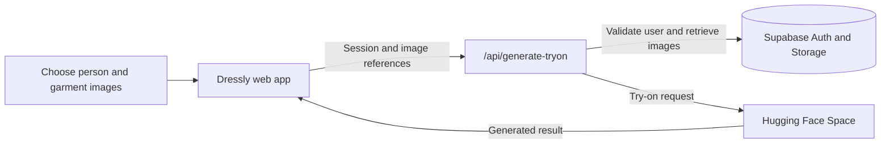

# Dressly: AI Virtual Try-On

Preview how a garment may look on you. Dressly combines a React try-on experience with Supabase authentication and image storage, then sends authorized requests to a Hugging Face Space for image generation.


## Contents

- [Features](#features)
- [How it works](#how-it-works)
- [Quick start](#quick-start)
- [Configuration](#configuration)
- [Scripts](#scripts)
- [Deployment](#deployment)
- [Security](#security)
- [Project structure](#project-structure)

## Features

- Sign in with email or Google through Supabase Auth
- Choose a sample garment, upload an image, or capture one with the camera
- Generate try-on results with progress feedback
- View and download the generated result
- Responsive interface with light and dark themes

## How it works

The app sends the signed-in user's session and image references to the API. The API validates the session, retrieves images from Supabase Storage, and requests a generated image from the configured Hugging Face Space.



## Quick start

**Requirements:** Node.js and npm.

1. Install dependencies:

   ```sh
   npm install
   ```

2. Create your local environment file:

   ```sh
   cp .env.example .env.local
   ```

   On PowerShell, use `Copy-Item .env.example .env.local` instead. Open `.env.local` and replace the Supabase sample values with your project URL and client key.

3. Start the frontend and local API:

   ```sh
   npm run dev
   ```

4. Open `http://localhost:5173`.

The frontend runs on port `5173`; the local API server runs on port `3001`.

## Configuration

| Variable | Required | Description |
| --- | :---: | --- |
| `VITE_SUPABASE_URL` | Yes | Supabase project URL used by the web app |
| `VITE_SUPABASE_ANON_KEY` | Yes | Supabase client key used by the web app |
| `VITE_API_URL` | Yes | API base path; use `/api` with the included routes |
| `VITE_AUTH_REDIRECT_URL` | No | Optional sign-in and OAuth redirect URL |
| `HF_SPACE_NAME` | No | Hugging Face Space override; defaults to `yisol/IDM-VTON` |
| `SUPABASE_URL` | No | Server-side Supabase URL override; falls back to `VITE_SUPABASE_URL` |
| `SUPABASE_ANON_KEY` | No | Server-side Supabase client key override; falls back to `VITE_SUPABASE_ANON_KEY` |

`.env.example` is a safe template with placeholders. Copy it to `.env.local` for local values; Git ignores `.env.local` and other populated `.env.*` files.

## Scripts

| Command | Purpose |
| --- | --- |
| `npm run dev` | Run Vite and the local API server together |
| `npm run dev:client` | Run only the Vite frontend |
| `npm run dev:api` | Run only the local API server |
| `npm run lint` | Check the code with ESLint |
| `npm run build` | Build the production frontend |
| `npm run preview` | Preview the production build locally |

## Deployment

The repository includes Vercel configuration and API handlers in `api/`. Add the required Supabase values to the Vercel project environment. Add the production site URL to the Supabase Auth redirect URL allowlist. Set `HF_SPACE_NAME` only if you want to use a Space other than the default.

Camera capture requires HTTPS in production. It works on `localhost` during development.

## Security

- The `VITE_` prefix exposes a value to the browser build. Do not put service-role keys, Hugging Face tokens, or other private credentials in `VITE_` variables.
- The Supabase anon key is a client key; protect user data with appropriate Supabase Row Level Security and Storage policies.
- Keep populated `.env.local` files and deployment credentials out of Git. Commit the placeholder-only `.env.example` instead.
- If a credential has ever been committed, revoke or rotate it and remove it from Git history before publishing that history.

## Project structure

```text
api/                 Vercel API handlers
public/garments/     Sample garments for the gallery
scripts/             Local frontend and API development commands
src/                 React UI, authentication, and API services
```

See [`RELEASE_CHECKLIST.md`](RELEASE_CHECKLIST.md) for the project's release steps.
